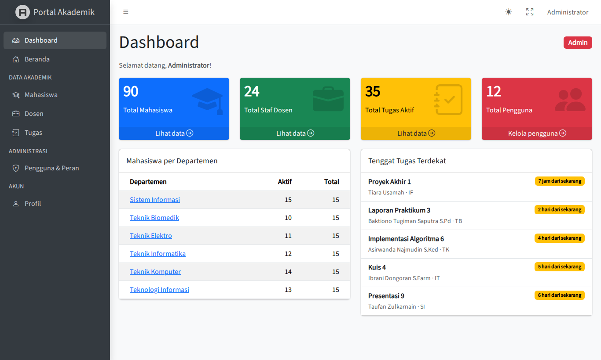
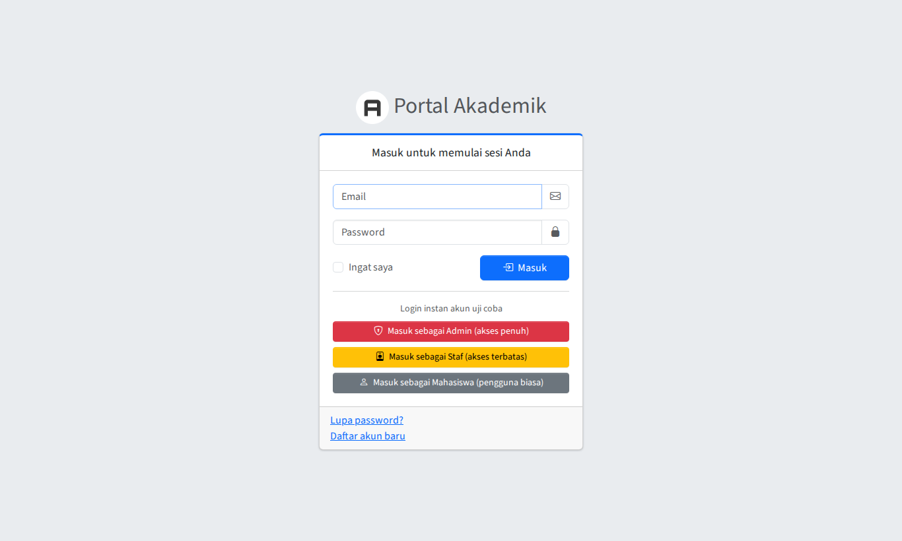
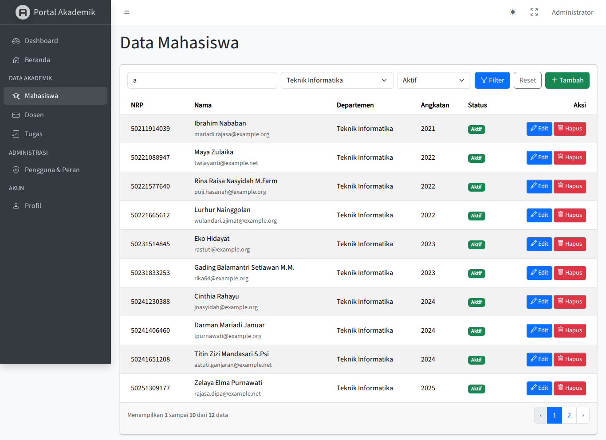
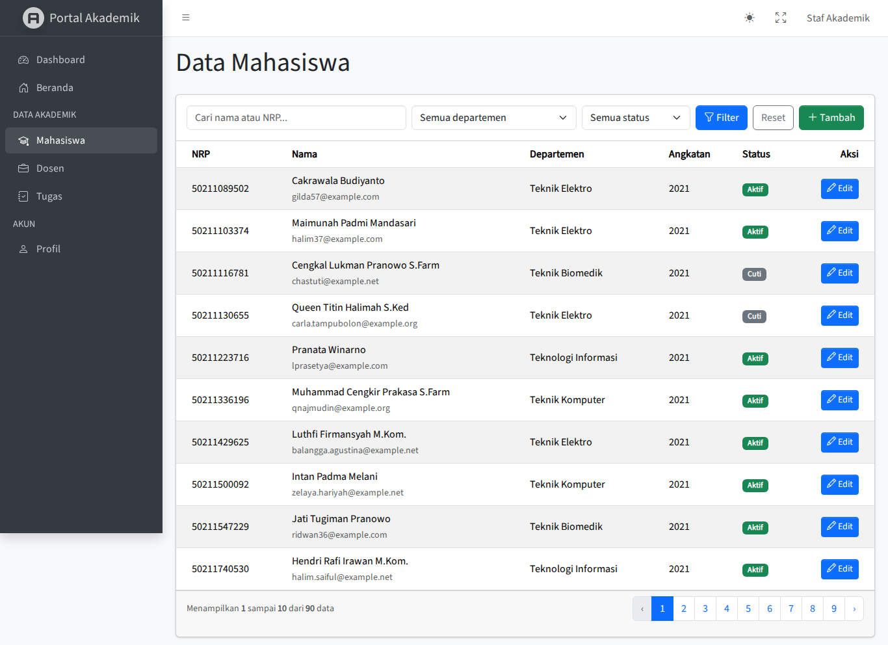
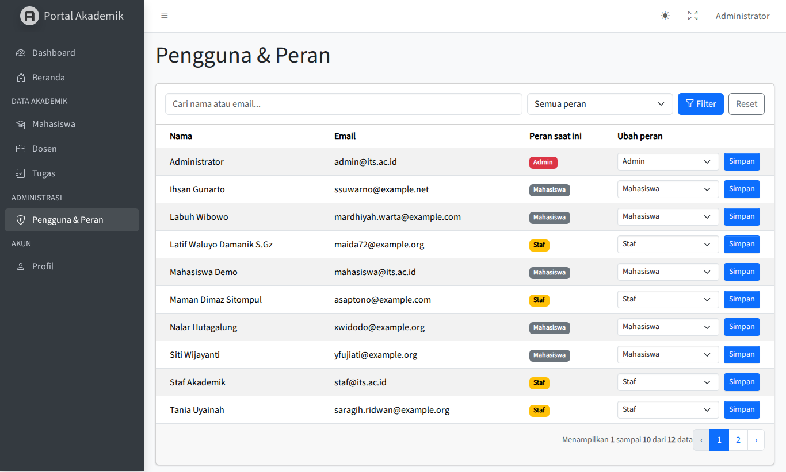
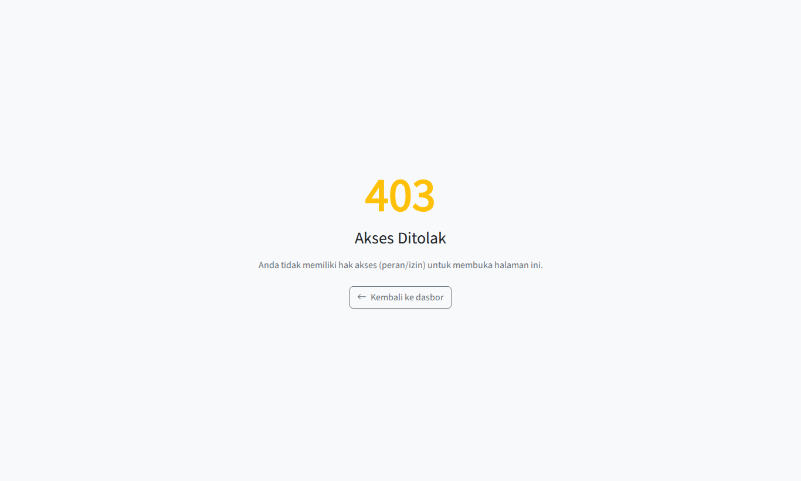

# Portal Akademik — Admin Dashboard & Role-Based Access Control

Tugas Mandiri PBKK Pertemuan 10: **Dashboard & RBAC Implementation**.

Portal akademik berbasis **Laravel 12** dengan panel admin **AdminLTE** (paket `jeroennoten/laravel-adminlte`),
autentikasi **Laravel Breeze**, dan otorisasi dinamis **Spatie Laravel Permission**.



## Fitur

| Spesifikasi tugas | Implementasi |
| --- | --- |
| Integrasi UI backoffice (AdminLTE) | Semua halaman panel mewarisi `@extends('adminlte::page')`; sidebar dinamis di `config/adminlte.php` dengan filter `can` |
| Sistem autentikasi Laravel Breeze | Login, register, lupa/reset password, verifikasi email, profil (view Breeze diganti tampilan AdminLTE) |
| Otorisasi DB Spatie | Tabel `roles`, `permissions`, dan pivot Spatie; trait `HasRoles` pada model `User` |
| Minimal dua peran | `admin` (akses penuh), `staf` (akses terbatas), dan `mahasiswa` (pengguna biasa) |
| Widget dashboard agregat | 4 widget `small-box`: Total Mahasiswa, Total Staf Dosen, Total Tugas Aktif, Total Pengguna (kueri `count()`) |
| Pengaman controller | Setiap controller admin memakai middleware `permission:` (`HasMiddleware`), mis. `permission:hapus-mahasiswa` hanya untuk `destroy` |
| Hak eksklusif hapus data | Tombol **Hapus** dirender dengan `@can('hapus-…')` dan aksi `destroy` dikunci middleware, sehingga request manual (Postman) dari staf tetap ditolak `403` |
| Pengalihan login berbasis peran | Admin/staf diarahkan ke `/admin/dashboard`, mahasiswa ke `/home` |
| Penguncian grup rute | Semua rute panel di bawah prefix `/admin` dengan middleware `auth` + `role:admin\|staf` |

### Tantangan tambahan (A+)

- **Filter pencarian `when()`** — keyword (nama/NRP), dropdown departemen, dan status aktif/cuti di tabel Mahasiswa; filter serupa di Dosen, Tugas, dan Pengguna.
- **Pengunci link pagination** — `->paginate()->withQueryString()` agar filter tidak hilang saat pindah halaman.
- **Auto-seeder Faker realistis** — `php artisan migrate --seed` mengisi 6 departemen, 24 dosen, 90 mahasiswa, puluhan tugas, dan pengguna (Faker locale `id_ID`).
- **Auto-login test accounts** — tombol login instan Admin / Staf / Mahasiswa di halaman login (aktif jika `DEMO_LOGIN=true`).

## Matriks Hak Akses

| Izin | Admin | Staf | Mahasiswa |
| --- | :---: | :---: | :---: |
| `akses-dashboard` | ✅ | ✅ | ❌ |
| `lihat-*` / `tambah-*` / `edit-*` (mahasiswa, dosen, tugas) | ✅ | ✅ | ❌ |
| `hapus-*` (mahasiswa, dosen, tugas) | ✅ | ❌ | ❌ |
| `kelola-pengguna` (ubah peran pengguna) | ✅ | ❌ | ❌ |

## Akun Uji Coba (Auto-Login Credentials)

Semua akun memakai password **`password`**.

| Peran | Email | Akses |
| --- | --- | --- |
| Admin | `admin@its.ac.id` | Panel admin penuh, hapus data, kelola pengguna & peran |
| Staf | `staf@its.ac.id` | Panel admin terbatas (lihat, tambah, edit) |
| Mahasiswa | `mahasiswa@its.ac.id` | Hanya beranda publik `/home`; `/admin/*` ditolak 403 |

Di halaman login tersedia tombol **Masuk sebagai Admin / Staf / Mahasiswa** untuk login instan saat demo.
Matikan dengan `DEMO_LOGIN=false` di `.env` untuk lingkungan produksi.

## Instalasi

Kebutuhan: PHP ≥ 8.2 (ekstensi `pdo_sqlite`), Composer. Node.js **tidak wajib** karena aset AdminLTE sudah tersedia di `public/vendor`.

```bash
git clone https://github.com/PBKK-B1/tugas-week10.git
cd tugas-week10
composer install
cp .env.example .env
php artisan key:generate
touch database/database.sqlite
php artisan migrate --seed
php artisan serve
```

Buka <http://localhost:8000/login>.

> Ingin memakai MySQL? Ubah `DB_CONNECTION`, `DB_DATABASE`, `DB_USERNAME`, dan `DB_PASSWORD` di `.env`, lalu jalankan `php artisan migrate:fresh --seed`.

### Tanpa PHP lokal (Docker)

```bash
docker run --rm -u "$(id -u):$(id -g)" -v "$PWD":/app -w /app composer:2 composer install
docker run --rm -u "$(id -u):$(id -g)" -v "$PWD":/app -w /app composer:2 sh -c "cp .env.example .env && php artisan key:generate && touch database/database.sqlite && php artisan migrate --seed"
docker run --rm -u "$(id -u):$(id -g)" -p 8000:8000 -v "$PWD":/app -w /app composer:2 php artisan serve --host=0.0.0.0
```

## Pengujian

```bash
php artisan test
```

Feature test (`tests/Feature/RbacTest.php`, `tests/Feature/DemoLoginTest.php`) menguji pengalihan login per peran,
blokir bypass URL admin, tombol hapus yang hanya tampil untuk admin, penolakan `DELETE` manual oleh staf,
perubahan peran, serta pencarian `when()` + `withQueryString()`.

Format kode mengikuti **PSR-12** (Laravel Pint, `pint.json`):

```bash
vendor/bin/pint --test
```

## Struktur Penting

```
app/Http/Controllers/Admin/      DashboardController, MahasiswaController, DosenController, TugasController, UserController
app/Http/Controllers/Auth/       AuthenticatedSessionController (redirect per peran), DemoLoginController
app/Models/                      User (HasRoles), Departemen, Dosen, Mahasiswa, Tugas
database/seeders/                RoleAndPermissionSeeder, UserSeeder, AkademikSeeder
resources/views/admin/           dashboard, mahasiswa, dosen, tugas, users (AdminLTE)
resources/views/auth/            halaman Breeze bergaya AdminLTE + tombol auto-login
routes/web.php                   grup rute /admin dengan middleware auth + role:admin|staf
config/adminlte.php              menu sidebar + filter izin
```

## Tangkapan Layar

| Login + auto-login | Dashboard admin |
| --- | --- |
|  |  |

| Tabel mahasiswa (admin, filter aktif) | Tabel mahasiswa (staf, tanpa tombol hapus) |
| --- | --- |
|  |  |

| Manajemen pengguna & peran | Mahasiswa membuka `/admin/dashboard` |
| --- | --- |
|  |  |
