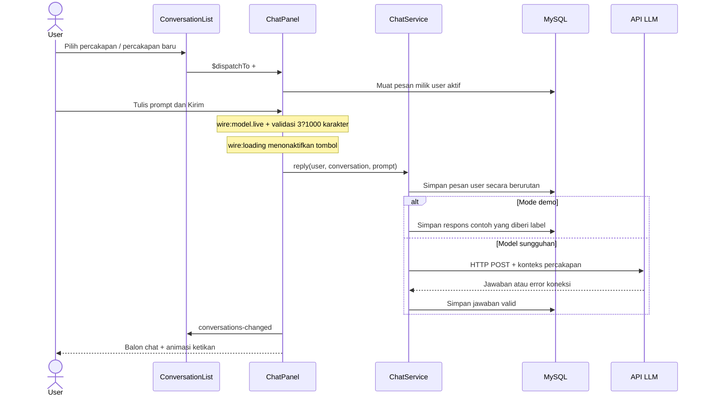

# Tugas 6 PBKK ? Secure & Reactive AI Chat Hub

Maulana ? 5025241001 ? Institut Teknologi Sepuluh Nopember

Workspace chat Laravel 12 + Livewire 3, login/register Laravel Breeze, API bearer-token Laravel Sanctum, dan riwayat percakapan relasional MySQL. Gaya indigo mengikuti tugas sebelumnya.

## Jalankan di perangkat ini

Aplikasi sudah disiapkan di **http://localhost:8006**.

```sh
composer run dev
```

Akun lokal: **maulana@its.ac.id** / **password**. Anda juga dapat mendaftarkan akun baru.

**Mode demo aktif** karena belum ada layanan LLM. Banner dan setiap balasan contoh menandai hal ini dengan jelas. Login, Livewire, penyimpanan MySQL, pergantian percakapan, dan animasi ketikan tetap berjalan. Respons demo bukan keluaran AI sungguhan.

MySQL khusus tugas ini berjalan di `127.0.0.1:3307`, dengan data di `storage/mysql/`. User aplikasi dibatasi ke `pbkk_tugas6` dan `pbkk_tugas6_test`; password tersimpan di `.env`. Layanan MySQL yang sebelumnya berjalan di port 3306 tidak diubah. Setelah restart komputer, jalankan instance khusus ini di terminal PowerShell:

```powershell
& 'C:\Program Files\MySQL\MySQL Server 8.0\bin\mysqld.exe' --no-defaults "--datadir=$PWD/storage/mysql" --port=3307 --bind-address=127.0.0.1 --mysqlx=OFF
```

Jangan menjalankan dua proses server pada data directory yang sama. Folder data, `.env`, token sesi, dan `vendor/` dikecualikan dari Git.

## Instalasi pada perangkat lain

Kebutuhan: PHP 8.2+, Composer, MySQL 8, ekstensi `pdo_mysql`. Node/Vite tidak diperlukan; aset frontend tersedia lokal.

1. Jalankan `composer install`.
2. Salin `.env.example` menjadi `.env`, lalu jalankan `php artisan key:generate`.
3. Buat database `pbkk_tugas6` dengan charset `utf8mb4`, dan isi `DB_HOST`, `DB_PORT`, `DB_DATABASE`, `DB_USERNAME`, `DB_PASSWORD` di `.env`.
4. Jalankan `php artisan migrate --seed` dan `composer run dev`.
5. Buka `http://localhost:8006`.

Seeder membuat akun demo hanya di lingkungan lokal/testing. Gunakan akun dan password sendiri untuk penggunaan di luar perangkat lokal.

## Hubungkan model AI sungguhan

Secara default `LLM_DEMO=true`. Saat memiliki layanan LLM, ubah menjadi `false` dan isi endpoint lengkap serta nama model:

```dotenv
LLM_DEMO=false
LLM_URL=http://127.0.0.1:11434/api/chat
LLM_MODEL=qwen3:14b
LLM_API_KEY=
LLM_TIMEOUT=60
```

Contoh di atas mengikuti endpoint Ollama pada materi kuliah; Ollama dan modelnya **belum terpasang**. Jika memilih Ollama, instal dari situs resminya lalu unduh model yang sesuai kapasitas perangkat. Anda juga dapat memakai endpoint Senopati atau API kompatibel Chat Completions: arahkan `LLM_URL` ke endpoint lengkap, isi model dan API key. Client menerima format respons `message.content` dan `choices[0].message.content`.

Jalankan `php artisan config:clear` setelah mengubah `.env`. API key hanya dipakai backend dan tidak dikirim ke browser. Tidak ada fallback diam-diam dari mode LLM sungguhan ke respons demo.

## Alur Livewire



## Kriteria tugas

- Dua komponen: `ConversationList` dan `ChatPanel`, berkomunikasi melalui events dan listener `#[On]`.
- Panel dilindungi middleware `auth` Breeze. Semua pemilihan, pembacaan, dan pengiriman dibatasi `user_id` aktif; ID percakapan Livewire dikunci dengan `#[Locked]`.
- Tombol dan textarea memakai `wire:loading.attr="disabled"`; lock server mencegah dua request memproses percakapan yang sama bersamaan.
- Model `ChatMessage` menyimpan prompt dan jawaban ke MySQL berdasarkan urutan ID.
- Koneksi gagal ditampilkan dengan pesan aman. Prompt tetap tersimpan dan tombol **Coba lagi** meminta jawaban ulang tanpa menambahkan prompt duplikat.
- Tampilan split-panel responsif, tema terang/gelap, output Markdown yang menolak raw HTML/link berbahaya, dan input berlabel.
- Bonus: simulasi pengetikan bertahap dengan Alpine bawaan Livewire; **bukan SSE streaming**. Preferensi reduced-motion dihormati.

## API Sanctum

Kirim header `Accept: application/json` dan `Content-Type: application/json`.

| Metode | Endpoint | Kegunaan |
| --- | --- | --- |
| POST | `/api/token` | Body `email`, `password`; mendapat bearer token berlaku 1 hari |
| POST | `/api/chat` | Body `prompt`, opsional `conversation_id`; menyimpan prompt dan jawaban |
| GET | `/api/conversations/{id}/messages` | Membaca pesan milik akun aktif secara berurutan, dengan pagination |
| DELETE | `/api/token` | Mencabut token yang sedang dipakai |

Semua endpoint kecuali penerbitan token memerlukan `Authorization: Bearer <token>`. Login token dibatasi 5 request/menit dan rute chat API 20 request/menit. Frontend Livewire memakai sesi Breeze, bukan menyimpan bearer token di JavaScript.

## Pengujian

```sh
php artisan test --compact
php artisan view:cache
```

Pengujian standar memakai SQLite in-memory supaya data demo tetap aman. Suite yang sama juga telah dijalankan terhadap MySQL lokal di database terpisah `pbkk_tugas6_test`: autentikasi, isolasi user, events, persistence, validasi, output aman, locking, retry, demo, format respons LLM, dan token API.

Riwayat UI dibatasi 100 pesan terakhir dan sidebar 50 percakapan terbaru. Semua pesan tetap ada di database; konteks yang dikirim ke LLM dibatasi 40 pesan terakhir. Tidak ada tool scanning, shell execution, atau fitur agent otonom dalam tugas ini.

## Tangkapan layar & demo kelas

Capture browser otomatis belum berhasil karena alat Computer Use tidak dapat memastikan URL browser. Untuk dokumentasi pengumpulan, ambil tangkapan layar `/chat` setelah login dan satu percakapan demo, lalu simpan di `docs/screenshots/` dan tambahkan ke README. Jangan menyertakan `.env` atau kredensial.

Demo 5 menit: login ? kirim prompt ? lihat animasi ketikan ? buat percakapan baru ? buka riwayat ? reload ? jelaskan mode demo/konfigurasi LLM dan relasi database. Hubungkan LLM sungguhan sebelum mendemonstrasikan kriteria konektivitas model.
